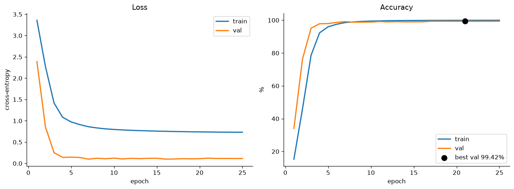
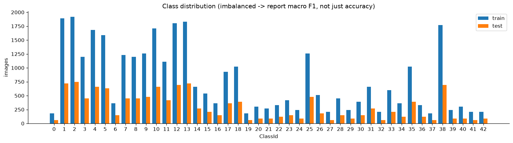
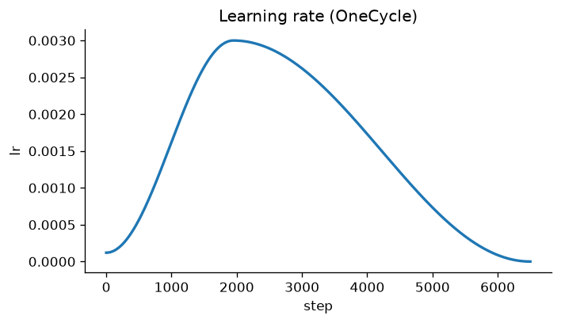
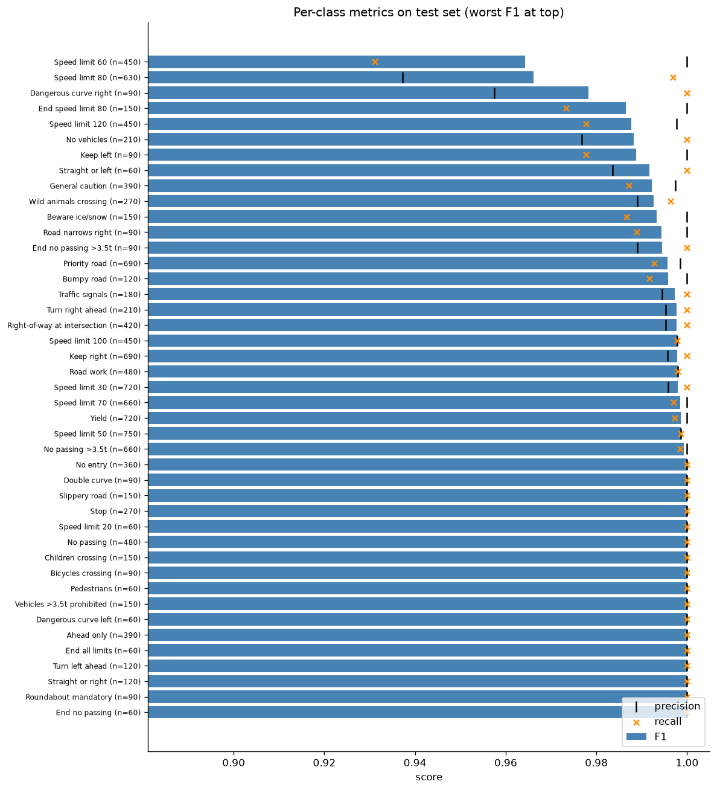
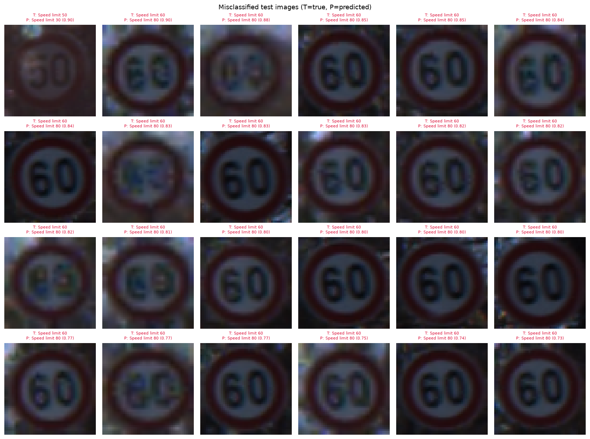
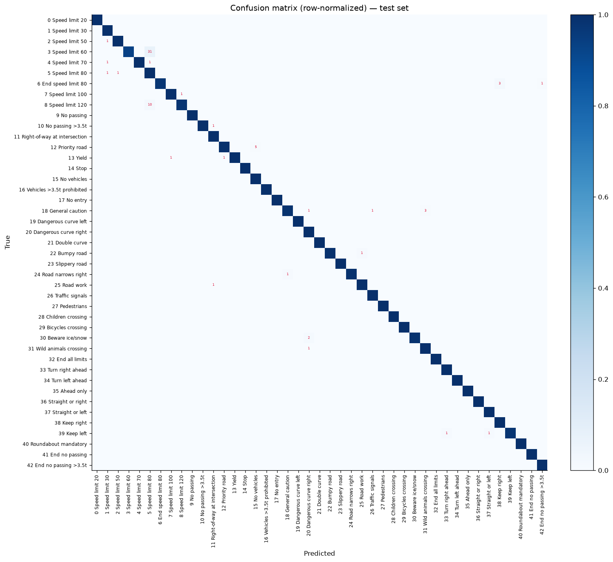
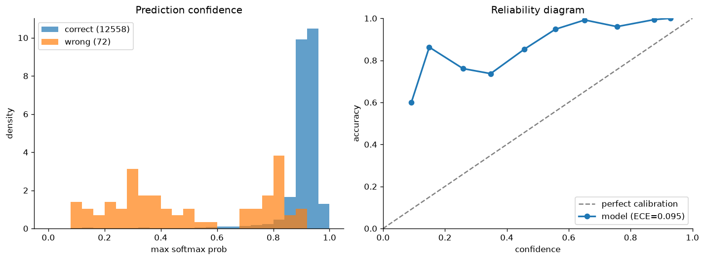

# GTSRB traffic-sign classifier (PyTorch, Docker)

A compact CNN that classifies the 43 sign types of the **German Traffic Sign Recognition Benchmark (GTSRB)**. Training, testing, plotting and prediction all run inside Docker on the GPU.

**Result: 99.43% accuracy on the official 12,630-image test set (72 errors), macro F1 0.995, in about 3 minutes of training on a laptop RTX 4050.**



---

## Contents

1. [Quick start](#1-quick-start)
2. [Project layout](#2-project-layout)
3. [The dataset](#3-the-dataset)
4. [How the code works](#4-how-the-code-works)
5. [Results](#5-results)
6. [Saved model and how to load it](#6-saved-model-and-how-to-load-it)
7. [Runtime](#7-runtime)
8. [Design choices](#8-design-choices)
9. [Configuration reference](#9-configuration-reference)
10. [Troubleshooting](#10-troubleshooting)

---

## 1. Quick start

**Requirements**
- Docker with the NVIDIA Container Toolkit. Docker Desktop with WSL2 already includes it. Check that a container can see the GPU:
  ```bash
  docker run --rm --gpus all nvidia/cuda:12.4.1-base-ubuntu22.04 nvidia-smi
  ```
- The Kaggle dataset `meowmeowmeowmeowmeow/gtsrb-german-traffic-sign`, unzipped into `./archive`. It must contain `Train/`, `Test/`, `Meta/`, `Train.csv` and `Test.csv`.

**Run**
```bash
docker compose build                       # once; the pytorch base image is ~4 GB
docker compose run --rm train              # train; writes the model + training plots
docker compose run --rm evaluate           # test set metrics + evaluation plots
docker compose run --rm predict data/gtsrb/Test/00000.png data/gtsrb/Test/00001.png
```

Any hyperparameter can be overridden on the command line:
```bash
docker compose run --rm train --epochs 40 --lr 2e-3 --output-dir outputs/run2
docker compose run --rm evaluate --output-dir outputs/run2
```

Everything goes to `./outputs/` on your machine. The container runs as your user, so you own the files.

---

## 2. Project layout

```
.
├── archive/                # dataset (not in git), mounted read-only at /app/data/gtsrb
├── outputs/                # model + plots + metrics, mounted at /app/outputs
├── src/
│   ├── __init__.py
│   ├── config.py           # all hyperparameters and paths, plus CLI parsing
│   ├── classes.py          # the 43 human-readable class names
│   ├── data.py             # Dataset, ROI crop, augmentation, track-based split, DataLoaders
│   ├── model.py            # TrafficSignCNN (593,675 parameters)
│   ├── engine.py           # train_one_epoch() and evaluate() loops
│   ├── utils.py            # seeding, device, checkpoint save/load, early stopping
│   └── plots.py            # every figure
├── train.py                # entry point 1: train and save the model
├── evaluate.py             # entry point 2: test-set metrics and plots
├── predict.py              # entry point 3: classify arbitrary image files
├── Dockerfile
├── docker-compose.yml
├── requirements.txt
└── .gitignore
```

### Docker setup

- **`Dockerfile`**: starts from `pytorch/pytorch:2.14.1-cuda12.6-cudnn9-runtime`, which provides Python 3.12, torch, torchvision, CUDA and cuDNN. It installs the small extras from `requirements.txt` and copies in `src/` and the three scripts. `PIP_BREAK_SYSTEM_PACKAGES=1` is set because the base image marks its system Python as externally managed (PEP 668), and torch lives in that interpreter. That's safe inside a throwaway container.
- **`docker-compose.yml`**: defines three services, `train`, `evaluate` and `predict`. They share one image and differ only in their entrypoint. Each service:
  - reserves all NVIDIA GPUs;
  - mounts `./archive` read-only at `/app/data/gtsrb`, the default `data_dir`;
  - mounts `./outputs` at `/app/outputs`;
  - sets `shm_size: 4gb`, because DataLoader worker processes pass batches through `/dev/shm`, and Docker's 64 MB default crashes them;
  - runs as `${UID}:${GID}` so the output files aren't owned by root.
- **`.dockerignore`**: keeps the dataset and outputs out of the build context, which makes builds fast and the image small.

---

## 3. The dataset

| Split | Images | Source |
|---|---|---|
| Train | 33,359 | `Train.csv`, minus the validation tracks |
| Validation | 5,850 | 15% of the training *tracks* in each class |
| Test | 12,630 | `Test.csv`, the official benchmark test set |

- **43 classes**, heavily imbalanced: from about 210 to 2,250 training images per class. See `outputs/class_distribution.png`.
- Images are small and vary in size: roughly 25×25 up to about 250×250 px.
- Each CSV row has the image size, a **region of interest (ROI)** bounding box around the sign, the `ClassId`, and the image path.
- The training set is made of **tracks**. A track is about 30 consecutive frames of the same physical sign, filmed as a car approaches it. The filename `00020_00007_00015.png` means class 20, track 7, frame 15. The validation split relies on this (see §4.3).



---

## 4. How the code works

### 4.1 `src/config.py`: one source of truth

A single `@dataclass Config` holds every path and hyperparameter. `parse_args()` builds an `argparse` parser **from the dataclass fields**, so a new field automatically becomes a CLI flag (`data_dir` becomes `--data-dir`), and the two can never drift apart. Booleans accept `true/false/1/0/yes`. `cfg.ckpt_path` is always `<output_dir>/best_model.pt`, and `cfg.to_dict()` makes the config JSON-serialisable so it can be saved in the checkpoint.

### 4.2 `src/classes.py`

A list of the 43 class names, indexed by `ClassId`, e.g. `CLASS_NAMES[14] == "Stop"`. Plots, reports and predictions use it.

### 4.3 `src/data.py`: loading, augmentation, splitting

- **`GTSRBDataset`**: reads rows from a CSV, opens each PNG as RGB and crops it to the **ROI box** (`Roi.X2/Y2` are inclusive, hence the `+1` for PIL). It then applies the transform. It exposes `.targets` so the class-distribution plot doesn't have to load any images.
- **`build_transforms(img_size)`**:
  - *train*: resize to 48×48, then a random affine transform (±10° rotation, ±10% shift, 0.9–1.1 scale, 5° shear), then colour jitter (brightness, contrast, saturation), then convert to a tensor and normalise.
  - *eval*: resize, convert to a tensor and normalise. Nothing random.
  - There is **no horizontal flip**: flipping "Turn left ahead" makes it "Turn right ahead", so flips would create wrong labels.
  - Normalisation uses GTSRB's own per-channel mean and std, not ImageNet's.
- **`split_by_track()`**: groups training rows by track (`class_track` key), then for **each class** holds out 15% of its tracks for validation, with a fixed seed. Splitting by single image would put near-identical frames of the same sign in both train and validation, giving a fake ~99.9% validation accuracy. Splitting by track makes validation a fair stand-in for the test set: 99.42% on validation vs 99.43% on test.
- **`build_loaders(cfg)`**: returns `train`, `val` and `test` DataLoaders. The train loader shuffles and uses `drop_last`. Pinned memory is used when a GPU is present, and worker processes persist between epochs.
- **`denormalize()`**: undoes the normalisation so images can be plotted.

### 4.4 `src/model.py`: `TrafficSignCNN`

A small VGG-style network with **593,675 parameters**:

```
input 3×48×48
 ├─ conv_block(3→32)    → 32×24×24
 ├─ conv_block(32→64)   → 64×12×12
 ├─ conv_block(64→128)  → 128×6×6
 ├─ AdaptiveAvgPool(3×3)→ 128×3×3
 └─ classifier: Flatten → Linear(1152→256) → ReLU → Dropout(0.3) → Linear(256→43)

conv_block = [Conv3×3 → BatchNorm → ReLU] ×2 → MaxPool2 → Dropout2d(0.15)
```

- Two stacked 3×3 convolutions see a 5×5 area with fewer weights than one 5×5 convolution, and add an extra non-linearity.
- `bias=False` on the convolutions, because the BatchNorm right after them already learns a shift.
- `Dropout2d` drops whole feature maps, which regularises convolutional layers better than element-wise dropout.
- Because of `AdaptiveAvgPool2d((3,3))`, the head works with any input size, so `--img-size 64` needs no code changes.
- Weights start with Kaiming initialisation, which suits ReLU networks.

### 4.5 `src/engine.py`: training and evaluation loops

- **`train_one_epoch()`**: for each batch: zero the gradients, run the forward pass under `torch.autocast` (mixed precision: fp16 on the GPU), compute the loss, back-propagate through `GradScaler` (which stops small fp16 gradients from rounding to zero), take an optimiser step, then a **scheduler step**, since OneCycle updates per batch. If `lr_log` is passed, it records the learning rate at each step for the LR plot. Returns the mean loss and accuracy.
- **`evaluate()`**: runs under `@torch.no_grad()` in eval mode, so dropout is off and BatchNorm uses its running statistics. Returns the loss, accuracy, and the raw targets and softmax probabilities, which `evaluate.py` uses for every metric.

There's no plotting or file I/O in here, so the loops stay simple to test and reuse.

### 4.6 `src/utils.py`

- `set_seed()`: seeds Python, NumPy and torch (CPU and CUDA) so runs are reproducible.
- `get_device()`: picks CUDA if it's available and turns on `cudnn.benchmark`. The input size never changes, so cuDNN can benchmark once and use the fastest kernels.
- `save_checkpoint()`: saves a dict containing `model_state` (the state_dict), `config`, `epoch` and `val_acc`.
- `load_model()`: rebuilds the model from the saved config, loads the weights with `weights_only=True` (safe loading, no arbitrary pickle) and switches to eval mode.
- `EarlyStopping`: tracks the best validation accuracy and stops after `patience` epochs without improvement.

### 4.7 `src/plots.py`

Each function takes arrays and writes one PNG. It uses the headless `Agg` backend because Docker has no display.

| Function | Figure |
|---|---|
| `plot_history` | train/val loss and accuracy per epoch, best epoch marked |
| `plot_lr` | learning rate at every optimiser step |
| `plot_class_distribution` | images per class, train vs test |
| `plot_confusion_matrix` | 43×43 row-normalised matrix (diagonal = recall); off-diagonal error counts in red |
| `plot_per_class_metrics` | precision, recall and F1 per class, worst at the top |
| `plot_confidence` | histogram of confidence for right vs wrong predictions, and a reliability diagram with ECE |
| `plot_misclassified` | grid of the most confident mistakes |

### 4.8 `train.py`

1. Parse the config, seed everything, pick the device. Mixed precision is used only on CUDA.
2. Build the loaders, then save `config.json` and `class_distribution.png`.
3. Set up the model, the loss and the optimiser:
   - **Loss**: `CrossEntropyLoss(label_smoothing=0.1)` for training, plain cross-entropy for validation so the numbers compare across settings.
   - **Optimiser**: `AdamW(lr=3e-3, weight_decay=1e-4)`.
   - **Scheduler**: `OneCycleLR`. The learning rate warms up for the first ~30% of steps, then anneals to almost zero.
4. Each epoch: train, validate, and save a checkpoint **only if validation accuracy improved**. Stop early if it hasn't improved for 6 epochs.
5. Save `history.json`, `training_curves.png` and `lr_schedule.png`.
6. Reload the best checkpoint and export it with `torch.export` (batch size left dynamic) to `model_exported.pt2`.

### 4.9 `evaluate.py`

Loads `best_model.pt` and runs the whole test set. It computes accuracy, top-3 accuracy, macro and weighted F1, ECE and the error count, plus a per-class `classification_report`. It writes `test_metrics.json`, `classification_report.txt` and four plots. The misclassified grid is sorted by confidence, so the "confidently wrong" cases come first.

### 4.10 `predict.py`

Loads the checkpoint, applies the eval transform at the training image size, and prints the top-k classes with their probabilities for each image path. Paths are **inside the container**: dataset images are under `data/gtsrb/...`. For your own pictures, drop them into `outputs/` and pass `outputs/<file>`. A tightly cropped sign works best, because training used ROI crops.

```
$ docker compose run --rm predict data/gtsrb/Test/00000.png data/gtsrb/Test/00001.png

data/gtsrb/Test/00000.png
   95.76%  [16] Vehicles >3.5t prohibited     ← correct (ClassId 16)
    0.24%  [ 8] Speed limit 120
    0.23%  [30] Beware ice/snow

data/gtsrb/Test/00001.png
   93.09%  [ 1] Speed limit 30                ← correct (ClassId 1)
    0.39%  [ 5] Speed limit 80
    0.29%  [40] Roundabout mandatory
```

---

## 5. Results

Default config, seed 42, RTX 4050 Laptop GPU.

### 5.1 Headline test metrics (`outputs/test_metrics.json`)

| Metric | Value |
|---|---|
| **Accuracy** | **99.43%** (12,558 / 12,630) |
| Top-3 accuracy | 99.95% |
| Macro F1 | 0.9951 |
| Weighted F1 | 0.9943 |
| Errors | 72 |
| Test loss (plain CE) | 0.128 |
| Expected Calibration Error | 0.095 |

For context: the original GTSRB competition reported about 98.8% human accuracy, so this small model is in the same range.

### 5.2 Training

- Validation accuracy goes 34% → 76% → 95% → 98% over the first four epochs, then climbs slowly to a **best of 99.42% at epoch 21**, which is the saved checkpoint.
- Training accuracy ends at 99.96%. The training loss stays at about 0.73 instead of approaching 0. That floor is expected with label smoothing, which never lets the target probability reach 1. It doesn't mean the model is underfitting.
- Validation loss stays flat at about 0.10–0.12 after epoch 7 while accuracy keeps creeping up, so there's no real overfitting. Early stopping never triggered, and all 25 epochs ran.
- **Validation (99.42%) and test (99.43%) agree closely**, which confirms the track-based split gives an honest estimate.



### 5.3 Where it fails



Weakest classes (F1 < 0.99):

| Class | Precision | Recall | F1 | Test images |
|---|---|---|---|---|
| Speed limit 60 | 1.000 | 0.931 | 0.964 | 450 |
| Speed limit 80 | 0.937 | 0.997 | 0.966 | 630 |
| Dangerous curve right | 0.957 | 1.000 | 0.978 | 90 |
| End speed limit 80 | 1.000 | 0.973 | 0.987 | 150 |
| Speed limit 120 | 0.998 | 0.978 | 0.988 | 450 |
| No vehicles | 0.977 | 1.000 | 0.988 | 210 |
| Keep left | 1.000 | 0.978 | 0.989 | 90 |

Most common confusions:

| True → Predicted | Count |
|---|---|
| Speed limit 60 → Speed limit 80 | 31 |
| Speed limit 120 → Speed limit 80 | 10 |
| Priority road → No vehicles | 5 |
| End speed limit 80 → Keep right | 3 |
| General caution → Wild animals crossing | 3 |

**Speed limits account for more than half of all errors.** All the speed-limit signs have the same red ring and differ only in the digits. At 48×48 px, on dark or motion-blurred frames, a "6" and an "8" (or "12" and "8") are only a few pixels apart. The misclassified grid shows exactly this: almost every top mistake is a dim or blurry "60" read as "80".





### 5.4 Calibration



ECE is 0.095, and the reliability curve sits **above** the diagonal, so the model is **under-confident**: when it says 90%, it's right more often than 90% of the time. This is the expected side effect of label smoothing (0.1), which caps how peaked the softmax gets. Ranking and accuracy aren't affected. If you need calibrated probabilities, either train with `--label-smoothing 0` or fit a single temperature on the validation set. The wrong predictions do have clearly lower confidence than the right ones, so a confidence threshold works well to flag uncertain cases.

---

## 6. Saved model and how to load it

| File | Size | What it is |
|---|---|---|
| `outputs/best_model.pt` | 2.4 MB | `{"model_state", "config", "epoch", "val_acc"}`. The weights plus everything needed to rebuild the network. Used by `evaluate.py` and `predict.py`. |
| `outputs/model_exported.pt2` | 2.5 MB | A `torch.export` program: graph and weights together. Loads **without this repo's source code**. Batch size is dynamic. |

```python
# With this repo
from src.utils import load_model
model, ckpt = load_model("outputs/best_model.pt", device)

# Without this repo (input: N×3×48×48, normalised with the GTSRB mean/std in src/data.py)
import torch
model = torch.export.load("outputs/model_exported.pt2").module()
logits = model(x)   # N×43
```

`best_model.pt` stores a state_dict rather than a pickled `nn.Module`, so it still loads after the code is refactored, and it loads safely with `weights_only=True`.

`model_exported.pt2` contains the network only. Resizing to 48×48 and normalising with `MEAN=(0.3403, 0.3121, 0.3214)` and `STD=(0.2724, 0.2608, 0.2669)` is up to the caller.

---

## 7. Runtime

Measured on an RTX 4050 Laptop GPU (6 GB) under WSL2, with 4 DataLoader workers:

| Step | Time |
|---|---|
| First `docker compose build` | Mostly the ~4 GB base-image download; a rebuild takes seconds |
| `train` (25 epochs) | **About 3 minutes**: about 8.5 s per epoch, train and validation included |
| `evaluate` (12,630 images and all plots) | About 13 s |
| `predict` | A few seconds, mostly container start-up and model load |

On CPU only, expect training to be roughly 10–30× slower.

---

## 8. Design choices

- **Track-based validation split.** It keeps validation honest (§4.3). Here, validation and test differ by only 0.01 points.
- **ROI crop.** It removes the background before resizing, so more of the 48×48 pixels show the sign.
- **No horizontal flips.** Flipped arrow signs are a different class.
- **Macro F1 alongside accuracy.** With classes ranging from about 200 to 2,000+ images, a weak rare class could hide inside a high overall accuracy.
- **OneCycleLR + AdamW + label smoothing + mixed precision.** Fast, stable defaults: about 95% validation accuracy after only 3 epochs, and mixed precision roughly halves GPU time and memory.
- **Checkpoint by best validation accuracy, not last epoch.** Early stopping protects against a run that gets worse late on.
- **Saving a state_dict plus config, and a `torch.export` artifact.** The first is for this codebase, the second for deployment without it. `torch.export` is used because `torch.jit.script` is deprecated in torch 2.14.

---

## 9. Configuration reference

All fields live in `src/config.py` and can be overridden with `--flag-name value`.

| Flag | Default | Meaning |
|---|---|---|
| `--data-dir` | `data/gtsrb` | dataset root inside the container |
| `--output-dir` | `outputs` | where the model, plots and metrics go |
| `--img-size` | 48 | square input size |
| `--use-roi` | true | crop to the CSV bounding box |
| `--val-frac` | 0.15 | fraction of tracks per class held out for validation |
| `--num-workers` | 4 | DataLoader processes |
| `--epochs` | 25 | maximum epochs |
| `--batch-size` | 128 | |
| `--lr` | 3e-3 | OneCycle peak learning rate |
| `--weight-decay` | 1e-4 | AdamW decoupled weight decay |
| `--label-smoothing` | 0.1 | 0 gives better-calibrated probabilities |
| `--dropout` | 0.3 | classifier dropout (conv blocks use half) |
| `--patience` | 6 | early-stopping patience in epochs |
| `--seed` | 42 | |
| `--amp` | true | mixed precision (used only on CUDA) |

---

## 10. Troubleshooting

| Symptom | Fix |
|---|---|
| `could not select device driver "nvidia"` | Install the NVIDIA Container Toolkit, or enable WSL integration in Docker Desktop. |
| DataLoader "bus error" or shared-memory crash | Raise `shm_size` in `docker-compose.yml`, or pass `--num-workers 2`. |
| `FileNotFoundError: data/gtsrb/Train.csv` | The dataset isn't in `./archive`, or it's nested one folder too deep. |
| Base image pull fails with `dial tcp [2600:...]: cannot assign requested address` | Docker is trying IPv6 without an IPv6 route. Prefer IPv4: `echo 'precedence ::ffff:0:0/96 100' \| sudo tee -a /etc/gai.conf && sudo systemctl restart docker`, then retry. Finished layers are kept. |
| `error: externally-managed-environment` during build | Already handled by `PIP_BREAK_SYSTEM_PACKAGES=1` in the Dockerfile. |
| Output files owned by root | Run with `UID=$(id -u) GID=$(id -g) docker compose run ...`. Compose defaults to 1000:1000. |
